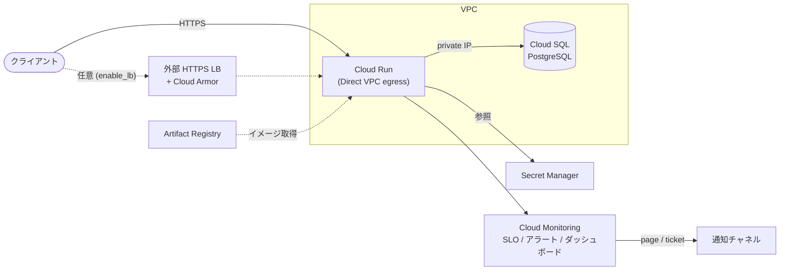
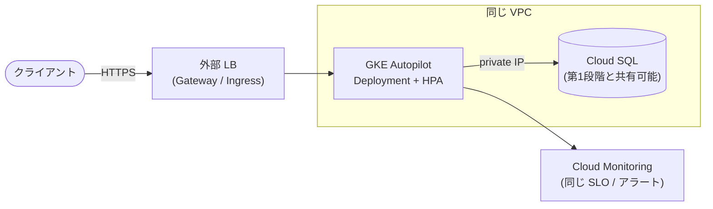

# 基本設計書

状態: **フェーズ 1（Cloud Run 構成）実装済み・実機未検証**（GKE Autopilot は未着手）
要件: [requirements.md](requirements.md) / 設計判断: [adr/](adr/)

> 「実装時に確認」と書いた項目は、GCP の仕様・料金・プロバイダの対応状況を、実装の段階で確認してから確定する。未確認のまま断定しない。

## 1. 全体構成

### 1.1 第1段階: Cloud Run



### 1.2 第2段階: GKE Autopilot（追加）



第2段階は、ネットワーク・DB・監視を第1段階と共有し、コンピュートだけを足す（[ADR 0004](adr/0004-compute-cloud-run-then-gke.md)）。

## 2. リポジトリ構成（予定）

```
.
├── main.tf / variables.tf / outputs.tf / versions.tf   # ルートモジュール（environments/ は作らない）
├── terragrunt.hcl          # GCS backend、-var-file=${ENV}.tfvars
├── dev.tfvars / prod.tfvars
├── modules/
│   ├── network/            # VPC、サブネット、private service access、(Cloud NAT)
│   ├── cloudrun/           # Cloud Run、サービスアカウント、オートスケール
│   ├── cloudsql/           # Cloud SQL (PostgreSQL)、Secret Manager
│   ├── armor/              # 外部 LB + Cloud Armor（enable_lb / enable_armor）
│   ├── monitoring/         # SLO、バーンレートのアラート、ダッシュボード、通知
│   └── gke/                # 第2段階
├── bootstrap/wif/          # Workload Identity Federation（初回のみ手動 apply）
├── tests/*.tftest.hcl      # terraform test（モックプロバイダ）
├── .github/workflows/      # CI / plan / deploy
├── .devcontainer/          # terraform / terragrunt / gcloud / git / gh
└── docs/                   # 本書、要件、SLO、コスト、ADR
```

環境（dev / prod）はルート直下の tfvars で切り替える（AWS 版と同じ。[ADR 0001](adr/0001-terragrunt-and-gcs-state.md)）。

## 3. 構成要素の設計

### 3.1 ネットワーク（`modules/network`）
- カスタムモードの VPC を作る（既定のネットワークは使わない）。
- Cloud SQL 用に private services access（VPC ピアリング）を設定する。
- Cloud Run は **Direct VPC egress** で VPC に接続する（Serverless VPC Access コネクタは使わない）。実装時に確認: 対応リージョンと、必要なサブネットの大きさ。
- インターネットへの外向き通信（外部 API 等）が必要な場合のみ、Cloud NAT を有効化する（`enable_nat`、既定 false）。DB への通信は VPC 内で完結するので、NAT 無しで動く構成を既定にする（AWS 版では NAT がコストの最大項目だった。[ADR 0005](adr/0005-cloud-sql-private-ip-and-secret-manager.md)）。

### 3.2 Cloud Run（`modules/cloudrun`）
- 実行用のサービスアカウントを専用に作り、必要最小限の権限だけを与える（Secret Manager の該当シークレットの参照、Cloud SQL への接続、ログ・メトリクスの書き込み）。
- 既定の `*.run.app` の URL で HTTPS を提供する。**未認証の公開**（`allUsers` に起動権限）にするかは変数で切り替える（既定は公開。サンプルが Web のため）。実装時に確認: 組織ポリシーでの制約の有無。
- オートスケール: 最小・最大インスタンス数を変数で指定。dev は最小 0（コスト優先、コールドスタートを許容）、prod は最小 1 以上。
- 環境変数・シークレット: DB のパスワードは Secret Manager のシークレットを**参照**として注入する（値を変数に持たない）。

### 3.3 Cloud SQL（`modules/cloudsql`）
- PostgreSQL。**private IP のみ**で、パブリック IP は付けない。
- dev: 小さいティア、単一ゾーン、削除保護なし。prod: 高可用（リージョン）、削除保護あり、バックアップとポイントインタイムリカバリ有効（AWS 版 RDS の dev / prod の差を踏襲）。
- パスワードは Terraform が `random_password` で生成して Secret Manager に格納する案と、IAM DB 認証の案がある。**実装時に確認**して [ADR 0005](adr/0005-cloud-sql-private-ip-and-secret-manager.md) で確定する。いずれも state に秘密が残る点を、トレードオフとして明記する（AWS 版は `manage_master_user_password` で state に残さなかったため、差が出る）。
- ディスク使用率のアラームを、唯一の原因系アラームとして用意する。

### 3.4 外部 HTTPS LB と Cloud Armor（`modules/armor`、任意）
- `enable_lb = true` で、serverless NEG を使う外部 Application LB を作る。`enable_armor = true` で Cloud Armor のポリシー（事前定義ルール）をアタッチする。
- Google 管理の証明書にはドメインが必要。**ドメイン無しの検証では有効化しない**。有効化する場合は、`domain_name` を指定して、DNS を自分で設定する。
- Cloud Run の ingress 設定を、LB 経由のみに絞るかは変数で切り替える（LB 有効時の推奨）。

### 3.5 監視（`modules/monitoring`）→ 詳細は [adr/0003](adr/0003-slo-based-alerting-with-native-slo.md) と `docs/slo.md`（実装時）

| 項目 | 設計 |
| --- | --- |
| SLI（可用性） | Cloud Run のリクエスト数に対する、5xx 以外の割合 |
| SLI（レイテンシ） | リクエストレイテンシの p95 が閾値以内 |
| SLO | 可用性 99.5%（30日）、レイテンシ p95 500ms（仮値。`slo_*` 変数で調整） |
| SLO の実装 | Cloud Monitoring の SLO（`google_monitoring_slo`）。実装時に確認: Cloud Run を対象にできる SLI の種類（基本の SLI か、リクエストベースの SLI か）。 |
| アラーム | SLO のバーンレートの条件を、長窓と短窓の AND で組む。緊急: 14.4 倍（1h と 5m）、チケット: 6 倍（6h と 30m）。AWS 版と同じ閾値。 |
| 原因系 | CPU・メモリ・インスタンス数・DB 接続数は、ダッシュボードのみ。例外: Cloud SQL のディスク逼迫。 |
| 通知 | 通知チャネルを緊急用とチケット用で分ける。メールの宛先は `alarm_email`（既定 null、リポジトリに書かない）。 |
| ダッシュボード | 最上段に SLO の達成率とエラーバジェット残量、その下に原因調査用のメトリクス。 |

AWS 版では、メトリクスの計算式を自前で組み、ダッシュボードのタイルの期間指定で不具合が出た。GCP 版は、SLO とバーンレートをネイティブ機能に任せて、自前の計算を減らす。ただし、ダッシュボードのタイルは、**実機で障害時の表示を必ず確認する**（受け入れ基準 4）。

### 3.6 GKE Autopilot（`modules/gke`、第2段階）
- Autopilot クラスタ（リージョン）を、同じ VPC の別サブネットに作る。Pod のサブネット範囲は、セカンダリ範囲で用意する。実装時に確認。
- Workload Identity で、Pod にサービスアカウントを紐づける（キーなし）。
- Deployment + HPA + Service（+ Gateway / Ingress）を、Terraform の `kubernetes` プロバイダか、Helm か、マニフェストで管理するか。 [ADR 0004](adr/0004-compute-cloud-run-then-gke.md) で比較する。
- SLI は、LB のメトリクス（HTTP(S) LB のログ・メトリクス）を使う。Cloud Run とは SLI の元データが違うため、`modules/monitoring` に、compute に応じた分岐を持たせるかを検討する。
- 料金: クラスタの管理料と Pod の課金が主になる。実装時に確認。

## 4. セキュリティ設計

| 項目 | 設計 |
| --- | --- |
| 認証（ローカル） | `gcloud auth application-default login`。長期キーは作らない |
| 認証（CI） | Workload Identity Federation。GitHub の OIDC トークンを、サービスアカウントの権限借用に使う（[ADR 0006](adr/0006-workload-identity-federation-and-sa-scope.md)） |
| 権限の分離 | plan 用 SA（閲覧 + state の読み書き）と、apply 用 SA（Environment `dev` / `prod` のジョブのみ） |
| 信頼条件 | リポジトリ名と、plan は `pull_request`、apply は Environment に限定（属性条件） |
| ネットワーク | DB は private IP のみ。Cloud Run の egress は VPC 経由 |
| 秘密情報 | Secret Manager。値はコード・変数・ログに出さない |
| 公開範囲 | プロジェクト ID・アカウント・メールは、リポジトリに書かない |
| スキャン | CI で、trivy 等の設定スキャン。指摘を除外する場合は、理由を付ける |

## 5. CI/CD 設計
AWS 版と同じ流れにする（[ADR 0002](adr/0002-trunk-based-development.md)）。

| ワークフロー | トリガー | 内容 |
| --- | --- | --- |
| CI | PR / main push | fmt、validate、lint、セキュリティスキャン、`terraform test` |
| plan | PR | WIF で認証し、`terragrunt plan` の結果を PR にコメント（fork の PR では動かさない） |
| deploy | main push → dev / タグ `v*` → prod | dev は変数（`AUTO_DEPLOY_DEV=true`）の時のみ。prod は Environment の承認と、タグが main 上のコミットであることを確認 |

- main の保護（PR 必須、必須チェック、linear history、force push 禁止）、squash のみ、マージ後のブランチ自動削除。
- 実機で未検証の範囲（WIF 連携など）は、README に明記する。

## 6. コスト設計
金額は、**実装段階で Pricing Calculator により試算し、実機検証で実績を記録する**。ここでは、費用が大きくなる要因だけを挙げる。

| 要因 | dev での方針 |
| --- | --- |
| Cloud SQL（インスタンス、ディスク、高可用） | 小さいティア・単一ゾーン。検証時のみ起動 |
| 外部 LB の転送ルール、Cloud Armor | 既定で無効（`enable_lb = false`） |
| Cloud NAT | 既定で無効（`enable_nat = false`） |
| Cloud Run | 最小インスタンス 0。リクエストが無ければ課金は僅少 |
| GKE Autopilot（第2段階） | クラスタの管理料と Pod の課金。検証時のみ起動 |
| ログ・メトリクス | 保存期間と量を抑える |

## 7. 検証計画

| 手順 | 内容 |
| --- | --- |
| 0 | 前提確認: 組織とプロジェクトの Org Policy（`gcloud org-policies list` と、有効な設定の確認。組織レベルは確認済み、ADR 0006）。予算アラートの設定。 |
| 1 | dev を apply（時刻を記録） |
| 2 | HTTPS で応答することを確認 |
| 3 | 擬似障害（例: Cloud Run のリビジョンを異常終了させる、または 5xx を返すイメージに差し替え）で、バーンレートのアラームが発火することを確認 |
| 4 | ダッシュボードの SLO タイルが、障害を反映することを確認 |
| 5 | destroy（時刻を記録）→ 残存リソースを CLI で確認（Cloud Run、Cloud SQL、VPC、Artifact Registry、Secret Manager、ログ バケット、LB、静的 IP、サービスアカウント） |
| 6 | 請求の実績を記録し、`docs/cost.md` に追記 |

AWS 版では、ALB 自身が返す 503 で擬似障害を起こした。GCP 版は、SLI の対象（Cloud Run の 5xx）を直接に検証できる。ただし、既定のサンプルイメージ（hello）は 5xx を返せないため、擬似障害の方法（起動に失敗するイメージへの差し替えなど）は、実機で決める。

## 8. フェーズ分け

| フェーズ | 内容 | 状態 |
| --- | --- | --- |
| 0 | 要件定義・基本設計（本書） | 完了 |
| 1 | Cloud Run 構成の実装（network / cloudrun / cloudsql / monitoring / armor、WIF、CI） | 実装済み（実機未検証） |
| 2 | GKE Autopilot の追加 | 未着手 |
| 3 | 実機検証と、実績の記録 | 未着手 |

## 9. 要件とのトレーサビリティ

| 要件 | 設計の箇所 |
| --- | --- |
| F-01 / F-02 | 3.2 Cloud Run |
| F-03 | 3.1 ネットワーク、3.3 Cloud SQL |
| F-04 | 3.3 Cloud SQL、4 セキュリティ（Secret Manager） |
| F-05 | 2 リポジトリ構成（tfvars）、ADR 0001 |
| F-06 | 3.2 Cloud Run（オートスケール） |
| F-07 | 3.4 外部 LB と Cloud Armor |
| F-08 | 3.5 監視、ADR 0003 |
| F-09 | 3.6 GKE Autopilot、ADR 0004 |
| 非機能 4.2 セキュリティ | 4 セキュリティ設計、ADR 0006 |
| 非機能 4.3 運用性 | 3.5 監視、`docs/slo.md` |
| 非機能 4.4 コスト | 6 コスト設計 |
| 受け入れ基準 1–6 | 5 CI/CD、7 検証計画 |
